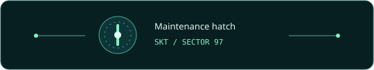

# mcp-secure-server

An executable Python reference for MCP authorization. Use the official SDK with verified token audiences and tenant-scoped reads. The demo uses synthetic data.

## Quick start

Requires Python 3.12+ and [uv](https://docs.astral.sh/uv/). From this repository:

```sh
uv run --locked mcp-secure-server
```

Without cloning, `uvx --from git+https://github.com/SkT97/mcp-secure-server mcp-secure-server` runs the current main branch.

The demo creates ephemeral RSA keys, binds loopback HTTP explicitly, discovers protected-resource metadata and calls the tools through the official SDK client. It verifies that a request without credentials is rejected and a north-tenant token cannot read a south-tenant record. No model, external credentials or Docker is required.

<picture>
  <source media="(prefers-color-scheme: dark)" srcset="assets/wave.svg">
  
</picture>

## How it works

<picture>
  <source media="(prefers-color-scheme: dark)" srcset="assets/workflow.svg">
  
</picture>

The verified identity supplies the tenant. Tool arguments cannot change it. A record from another tenant returns the same result as an unknown record. The downstream exchange adapter is standalone.

<details>
<summary>Authorization rules and standards</summary>

```text
trusted issuer → verified RS256 token → SDK authentication context → tenant-scoped records
                                             ↓
                                fixed downstream exchange adapter
```

- Validate signature, issuer, resource audience, expiry and required identity claims.
- Require `records:read`; take `tenant_id` exclusively from the verified principal.
- Take the signing key from one configured RSA public key, or from the JWKS at one configured HTTPS address (`jwks_url`): the token's `kid` only selects among the published keys. The JWKS fetch refuses redirects and oversized documents, keeps only RSA keys of 2048 bits or more for RS256, refreshes at most once per 30 seconds however many unknown `kid` values arrive, and drops cached keys after an hour of failed refreshes.
- Return the same response for another tenant's record and an unknown record.
- Bound tool arguments and synthetic output; enable SDK host protection.
- Require HTTPS in the client and exchange adapter, with an explicit loopback-only demo exception.
- Exchange a validated subject token at a fixed endpoint; refuse redirects and unchanged subject tokens. Never forward an inbound token implicitly.

`tenant_id`, `azp` and record permissions are this reference's application policy. They are not universal MCP requirements. The exchange adapter is standalone; record tools do not make downstream calls.

Sources checked **16 November 2026**: [MCP authorization, 2026-07-28](https://modelcontextprotocol.io/specification/2026-07-28/basic/authorization), [RFC 9728](https://www.rfc-editor.org/rfc/rfc9728.html), [RFC 8707](https://www.rfc-editor.org/rfc/rfc8707.html), [RFC 9700](https://www.rfc-editor.org/rfc/rfc9700.html) and [RFC 8693](https://www.rfc-editor.org/rfc/rfc8693.html). The [standards map](docs/standards.md) connects each boundary to its executable check.

The official [Python SDK](https://github.com/modelcontextprotocol/python-sdk) supplies protocol handling and auth context. This project concentrates on application boundaries. Keycloak's [supported standard token exchange](https://www.keycloak.org/securing-apps/token-exchange) is tested separately from mocked adapter failures.

</details>

<picture>
  <source media="(prefers-color-scheme: dark)" srcset="assets/wave.svg">
  
</picture>

## Verification

The November 19, 2026 Windows run passed 138 tests and the Keycloak lab with both key sources. See [verification](docs/verification.md) and the [threat model](docs/threat-model.md).

<details>
<summary>Run the Keycloak lab and see the recorded checks</summary>

With Docker available:

```sh
uv run --locked python examples/keycloak_integration.py
```

Add `--jwks` to take the signing keys from the realm JWKS instead of a PEM. That run also checks that a token signed by an unknown key is refused, both with an unknown `kid` and with the real `kid`.

This creates a dedicated, loopback-only Keycloak 26.8.2 container pinned by image digest, random temporary credentials and synthetic service accounts. It checks both tenant directions, wrong audience, missing scope, discovery and a real RFC 8693 exchange to a downstream audience. It verifies the exchanged signature and preserved subject, then removes its own container.

The local run on **16 November 2026** passed these checks:

| Probe | Observed result |
| --- | --- |
| No token / wrong audience | HTTP 401 / 401 |
| Missing required scope | HTTP 403 |
| Protected-resource metadata | HTTP 200; configured resource matches |
| Two authenticated tenants | Five own records each |
| Cross-tenant reads, both directions | Denied; indistinguishable from unknown ID |
| Tenant supplied as a tool argument | Escalation prevented |
| Downstream token exchange | Distinct signed token; target audience; original subject |

See [recorded verification](docs/verification.md) and the safe integration output for the [PEM key](results/keycloak.json) and the [JWKS](results/keycloak-jwks.json).

</details>

<details>
<summary>Development checks</summary>

```sh
uv sync --locked --group dev
uv run --locked python -m pytest -q
uv run --locked ruff check .
uv run --locked ruff format --check .
```

`uv.lock` pins the tested dependency graph. CI is configured for Linux and Windows, with the Keycloak lab on Linux.

</details>

### Upstream conformance evidence

Run **MCP conformance evidence** from GitHub Actions for an official
`2026-07-28` smoke test of `tools/list`. Choose **full_sweep** to record the
complete upstream server requirement set. Many full-sweep cases expect
tools and resources from the upstream reference fixture. The workflow pins the
[upstream runner](https://github.com/modelcontextprotocol/conformance/tree/74edef34d674f563537be8c6587cebaa58e830ca)
and publishes only check status and scenario names. Failed, skipped and missing
results are reported separately. The workflow preserves the upstream exit code.

The runner uses a test-only client shim because its server command offers no
bearer-token option at this revision. The shim sends an ephemeral token only to
the exact loopback demo endpoint and refuses redirects there. The real server
verifies it normally. Pass `--anonymous` to run without credentials. The
separate Keycloak job verifies scope, tenant isolation and token exchange.

On November 18, 2026 the local Windows smoke passed. In the full sweep,
12 of 37 required scenarios passed. The full runner returned exit code 1.
Its scenario set includes capabilities and fixture tools beyond this example.

To run the same check locally, build the pinned runner from a trusted checkout
or source archive with `npm ci`. The example checks the checkout revision when
Git metadata is present and fingerprints the entry point, lockfile and
requirement set. Then run:

```sh
uv run --locked python -m examples.conformance --runner-root ../conformance --json-out conformance.json --smoke
```

## Limits

This is a small read-only reference, not a production deployment or security certification. The demo and Docker lab use synthetic service accounts; they do not implement interactive user login, consent or a complete OAuth client.

The trusted key source is operator-configured: one RSA public key, or a JWKS address. The JWKS path is also checked against the Keycloak lab. Production integration still needs TLS termination, ingress body/rate limits, request budgets, operational logging and deployment hardening. Authentication does not make retrieved content safe against prompt injection. See the [threat model](docs/threat-model.md).

<details>
<summary>Maintenance hatch · 97</summary>

<picture>
  <source media="(prefers-color-scheme: dark)" srcset="assets/side-quest.svg">
  
</picture>

</details>

## License

[Apache-2.0](LICENSE).
